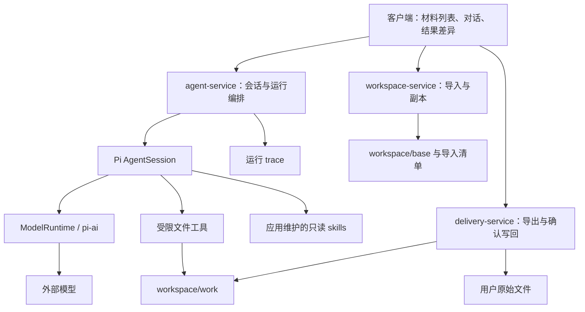

# xuwu-file-agent 首版架构设计

设计日期：2026-09-27。本文保留首版设计依据，实际实现以当前源码为准；验证方式见 [README.md](./README.md#验证)。

## 1. 核心方案

采用 **Electron 桌面客户端 + TypeScript 应用服务 + Pi SDK + 受限文件工具**。

一个用户会话关联一个独立 workspace。用户添加的文件与目录复制进 workspace，Agent 通过工具修改副本；客户端展示结果差异，用户选择导出，或者确认将指定变更应用回原件。

Pi 承担会话、Agent loop、模型通信和上下文压缩。应用承担输入材料、权限边界、文件操作、运行预算、交付以及可导出的 trace。首版采用一个应用、一个本地后端，不引入数据库、微服务、任务编排平台或第二套 Agent loop。

核对基线：官方 `earendil-works/pi`，发布版本 `0.87.1`，tag 对应 `f07218c4d4bbc12bef056a7058c3dd49dfe41abe`，Node 要求 `>=22.19.0`。实施时固定版本并提交依赖锁文件；Electron 内置 Node 也必须满足要求，不能只检查系统 Node。[Pi 包信息](https://github.com/earendil-works/pi/blob/f07218c4d4bbc12bef056a7058c3dd49dfe41abe/packages/coding-agent/package.json)



这里的 workspace 是文件工作的业务环境。**设置 `cwd` 并不构成权限沙箱**：Pi 内置文件工具支持绝对路径等路径形式。必须在应用工具中强制限制访问；原件写回不能注册成模型可调用工具。[Pi 路径实现](https://github.com/earendil-works/pi/blob/f07218c4d4bbc12bef056a7058c3dd49dfe41abe/packages/coding-agent/src/core/tools/path-utils.ts)

## 2. 产品范围与客户端

首版以 Windows 本地桌面端为基线，提供：

- 材料列表：添加文件、添加目录、拖拽添加、继续追加、移除输入项；显示导入中、成功、部分成功和失败原因。
- 对话区域：输入任务、多轮追问、流式输出、工具执行状态、停止当前运行；运行中发来的新任务默认排队。
- 结果区域：新增、修改、删除、移动的清单及文本差异；支持继续修改、导出文件/ZIP、选择变更后应用回原件。
- 会话恢复与 trace 导出。

Windows 的原生选择框不能同时作为文件和目录选择器，所以“添加”按钮可以展开为“添加文件”和“添加目录”两个选项；两种选择都追加到同一材料列表。文件选择支持多选，目录可以反复追加，拖拽支持混合输入。[Electron 对话框说明](https://www.electronjs.org/docs/latest/api/dialog)

Electron 的主进程处理原生对话框和文件权限，preload 仅暴露具体业务接口。渲染进程关闭 Node 集成，开启上下文隔离和沙箱；Markdown/HTML 文件作为不可信内容显示，不执行其中的脚本。拖拽路径通过受控 preload 处理。[拖拽路径接口](https://www.electronjs.org/docs/latest/api/web-utils)、[Electron 安全指南](https://www.electronjs.org/docs/latest/tutorial/security)

模型通常在外部服务运行，因此“文件在本地”不代表“内容不会离开设备”。界面应明确模型供应商以及被读取片段会发送给模型；密钥由宿主管理，不进入前端、工具结果或 trace。

首版编辑 UTF-8 / UTF-8 BOM 文本，保留原有 BOM、换行形式和末尾换行。其他编码明确报告；二进制文件可作为目录中的不透明附件保留、原样导出，但不交给模型解析或修改。导入数量、总大小及单文件大小设有限额，超限或被跳过的项目必须可见，不能把部分导入标成全部成功。

## 3. Pi 与应用各自负责什么

| 能力 | 直接复用 Pi | 应用增加的职责 |
|---|---|---|
| Session | `AgentSession` 接收多轮输入；`SessionManager` 持久化 JSONL 及恢复当前上下文 | 产品会话与 workspace 对应关系、运行互斥、客户端事件转发 |
| Tools | 工具定义、模型工具调用、执行结果进入下一轮 | 受限文本/目录操作、路径校验、操作记录、结果大小限制 |
| Skills | 技能元数据索引，正文按需读取 | 仅加载受信应用目录；读取权限与加载 trace |
| 上下文 | 当前分支投影、消息转换、压缩摘要和近期历史 | 输入预算策略、真实文件变更摘要、超限处理 |
| Agent loop | 模型响应、工具执行、结果回填、继续或停止 | 可选累计预算与调用次数限制、重复失败控制、完成后校验 |
| Model client | `ModelRuntime` 与 `pi-ai` 的模型请求、流式响应、认证及重试能力 | 选择模型与凭据来源，设置有限重试、超时，统计调用 |

采用 `@earendil-works/pi-coding-agent` 的 `createAgentSession()` 与 `SessionManager` 路线。当前 Pi 另有 `AgentHarness` / `JsonlSessionRepo` API，本产品无需同时使用两套会话机制，也不套用旧版本的 Harness 示例。[SDK](https://github.com/earendil-works/pi/blob/f07218c4d4bbc12bef056a7058c3dd49dfe41abe/packages/coding-agent/docs/sdk.md)、[装配源码](https://github.com/earendil-works/pi/blob/f07218c4d4bbc12bef056a7058c3dd49dfe41abe/packages/coding-agent/src/core/sdk.ts)

`create-session.ts` 负责显式传入 workspace 的 `cwd`、持久化 SessionManager、ModelRuntime、受信 ResourceLoader、工具白名单与设置。它是装配入口，不承担文件处理业务。

恢复时重新装配模型、工具、资源和事件订阅，再打开保存的会话；不会把 JavaScript 工具函数当成会话内容序列化。会话历史以 Pi 为权威来源，UI 展示状态不再构造第二份供模型使用的 chat history。

对话进度分为 Agent 正文和程序状态。`instructions/system.md` 要求开始与关键阶段简述；`src/app/run-feedback.ts` 根据真实模型阶段、工具开始/结束事件，在正文静默超过配置间隔后聚合反馈，开始和结束立即提示，相同状态不重复追加。`src/app/activity-log.ts` 将程序状态保存在数据目录的 `activity/<sessionId>/messages.jsonl`，与 Pi 历史合并展示，但不送入模型。日志包含本轮用户消息的排序锚点，避免准备阶段状态排到用户请求前面；助手正文使用持久条目时间排序，避免长推理后的正文向上跳。停止、切换和释放会话时清理反馈定时器；删除会话同时删除该会话的状态记录。状态保存失败时保留内存中的反馈并明确提示，不中断文件处理。

## 4. Session、run 与文件状态

- **Session**：整段相关的用户对话，可跨多次打开客户端，绑定一个 workspace。
- **Run**：一次用户提交后直到 Agent 停稳的工作过程，可以包含多次模型和工具调用；内部重试、压缩不重置该 run 的预算。
- **模型轮次**：一次模型请求以及随后执行的工具批次。
- **文件状态**：以 workspace 中的实际文件和宿主变更记录为准，不以模型说“已经修改”作为依据。

同一个 workspace 同时只允许一个 run。第一版写操作串行执行；运行中新增文件或新任务进入队列，在前一 run 停稳后处理。用户点击停止，先取消并等候在途操作结束，再允许下一次写入。

运行状态采用简单枚举：`running`、`waiting_user`、`ready_for_review`、`cancelled`、`budget_exhausted`、`failed`。预算不足和工具失败不会被显示成“完成”。

Pi 的 `agent_end` 后还可能发生自动恢复或队列处理。客户端以 `agent_settled` 或 `session.prompt()` 完成为本次调用停稳的信号，随后再检查文件变更、工具失败和用户约束。`ready_for_review` 表示结果可检查；用户仍能继续对话修改，运行结束不等于业务目标必然达成。[SDK 事件语义](https://github.com/earendil-works/pi/blob/f07218c4d4bbc12bef056a7058c3dd49dfe41abe/packages/coding-agent/docs/sdk.md#subscribing-to-events)

一次典型流程：

1. 用户添加材料，宿主校验并创建导入清单和副本。
2. 用户提交任务，agent-service 找到会话并建立 run 记录。
3. 宿主向 Pi 提供用户输入、可用材料索引和当前真实变更概况。
4. Pi 准备上下文，请求模型；模型决定回答、读取 skill 或调用文件工具。
5. 工具执行校验、操作副本，返回有限大小的结果与证据；Pi 据此继续。
6. 达到停稳条件后，宿主生成文件差异和执行结果，客户端显示待检查成果。
7. 用户继续对话，或者导出/确认应用指定变更。

## 5. Workspace 与原件交付

每个导入根分配稳定 ID，例如两个不同来源的 `docs` 分别进入 `work/i001/docs/` 与 `work/i002/docs/`，保留各自目录结构。同一路径去重；同时选中父目录及其子文件时合并范围并在界面说明。第一版可拒绝后来追加的父目录与已有导入根重叠，避免运行中重映射已有工作路径。

导入清单保存来源 ID、原始路径、工作路径、类型、初始内容哈希及编码信息。原始绝对路径仅供宿主与用户界面使用，模型通常只需副本路径。

workspace 内分为：

- `base/`：导入时的只读基线，支持差异比较和恢复。
- `work/`：Agent 可以修改的副本。
- `manifest.json`：宿主维护的原件映射和基线信息。
- `operations.jsonl`：已提交变更及操作 ID。
- `trash/`：删除操作的可恢复内容。

复制文件内容，不使用硬链接作为副本。第一版拒绝符号链接、junction 和不支持的 reparse point；不通过它们递归访问其他目录。导入时检查，工具每次访问时也检查，不能只在最初检查一次。[Windows 链接语义](https://learn.microsoft.com/en-us/windows/win32/fileio/hard-links-and-junctions)

**交付由 delivery-service 执行：**

- 导出：输出单个文件或 ZIP，保持导入根的区分；不打包会话、凭据、trace、base 或回收区。
- 应用回原件：先展示逐项变更，将确认绑定到当前 workspace 版本及变更清单。确认后再发生修改，旧确认失效。
- 写回前重算原件哈希；原件被外部修改、原件消失或新建目标已存在，都标记冲突，禁止静默覆盖。
- 只应用本次选择的新增、修改、删除和移动，不删除原目录后整体复制。原目录在导入后新增的其他文件不受影响。
- 写回前建立备份，逐文件提交并记录进度；多文件更新不是一个整体原子事务，部分失败需要展示已成功/未成功项目，并支持从备份恢复。
- 再次写回以最后一次成功交付的基线检查冲突，并记录交付批次，避免把自己的上次写回误判成外部修改。

导入目录内新建文件可映射回该目录。单独导入一个文件不等于授权写入其整个父目录，新建兄弟文件默认仅导出；写回新位置需用户明确选择目标。跨导入根的移动表现为来源删除与目标新增，必须同时进入预览，不能凭文件名猜测目标。

## 6. 第一版工具

所有工具共用一套路径和文件操作服务；工具定义层只做参数映射与结果包装。

| 工具 | 作用 | 关键约束 |
|---|---|---|
| `list` | 浏览目录、按名称查找、返回类型/大小等信息 | 分页、深度和条目上限 |
| `search` | 在文本文件中查找内容 | 限定路径、限制匹配量，返回文件和行号 |
| `read` | 分段读取文本，返回内容版本哈希 | 行/字节分页；也可读取白名单内的只读 skill 文档 |
| `write` | 新建或整体重写文本文件 | 显式区分新建与替换；替换必须匹配预期哈希 |
| `edit` | 精确局部替换 | 检查预期哈希和匹配数量，匹配不唯一时拒绝猜测 |
| `mkdir` | 创建目录 | 只在工作目录内 |
| `move` / `copy` | 移动、重命名或复制文件与目录 | 默认拒绝覆盖现有目标，检查完整影响范围 |
| `delete` | 删除文件或目录 | 先移入宿主回收区；禁止工作根删除 |
| `changes` | 查看与基线相比的变更及差异 | 宿主计算，结果分页 |
| `restore` | 撤销指定操作或恢复基线文件 | 检查后续修改，防止撤销覆盖新工作 |

不注册通用 `bash`、PowerShell、任意代码执行、网络、邮件或提醒创建工具。文本文件任务可以由受限工具完成；将来确有特定批处理需求，再增加输入输出明确的专用工具。

普通工具只允许 workspace 内相对路径。`read` 为 Pi 的 skill 机制保留一个明确例外：允许读取已登记受信 skill 根内的文件；不能写这些文件，也不能藉此访问其他绝对路径。

路径策略必须处理 `..`、盘符相对路径、UNC/设备路径、ADS、大小写冲突以及真实路径边界。创建新文件时检查最近已存在父目录，提交前再核对；不能仅使用字符串前缀比较。宿主清单、会话、备份、trace 和配置都位于 Agent 可访问根之外。

这是应用工具层的访问边界。第一版不执行不可信代码，不宣称已经具有操作系统级沙箱。

## 7. Skill 渐进式加载

只发现应用维护的 `skills/`。启动阶段可读取本地文件以解析元数据，但进入模型上下文的只有技能名称、描述和路径；正文在模型认为需要时通过 `read` 加载，references 同样按需加载。技能名称匹配不构成正确选择的保证，验收需要实际任务覆盖。[Pi skill 格式化实现](https://github.com/earendil-works/pi/blob/f07218c4d4bbc12bef056a7058c3dd49dfe41abe/packages/coding-agent/src/core/skills.ts)

采用显式 ResourceLoader，固定系统提示和应用资源；导入目录中的 `AGENTS.md`、`CLAUDE.md`、`.pi` 设置、扩展及技能均当作用户文件，不能自动加载为指令或执行扩展。仅在模型读取实际正文时记录 `skill_load`；扫描目录的 `skill_discovered` 与正文加载分开记录。[资源加载接口](https://github.com/earendil-works/pi/blob/f07218c4d4bbc12bef056a7058c3dd49dfe41abe/packages/coding-agent/src/core/resource-loader.ts)

首版 skills 可包含文字步骤和参考资料；`scripts/` 目录可以保留，但不意味着开放任意脚本执行。需要执行的操作必须落到已注册、可校验的工具。

## 8. 上下文来源、预算与压缩

下一次模型请求由以下材料组成：

1. 应用基础指令与系统提示，统一由 `instructions/system.md` 维护，避免重复指令源。
2. 已启用的工具定义及 skill 元数据索引。
3. 当前分支的摘要、保留历史、最新用户输入。
4. 工具调用与工具结果，包括已按需读取的 skill 正文。
5. 宿主提供的材料索引、真实变更概况和必要运行状态。

模型名、输出限制、思考级别、超时等主要是请求配置；认证信息只用于通信，不作为提示词内容。完整持久化历史、当前活动上下文和文件实际状态分别管理。

Pi 原生压缩保留结构化摘要与近期消息，旧记录仍保存在会话中。0.87.1 会在工具结果回填后的后续轮次准备阶段检查压缩，也会在新用户输入和溢出恢复时检查。默认机制可复用，但不能据此声称已有产品级累计预算。[Pi 压缩参考](https://github.com/earendil-works/pi/blob/f07218c4d4bbc12bef056a7058c3dd49dfe41abe/packages/coding-agent/docs/compaction.md)

以下是当前应用策略，默认值由 `src/config.ts` 唯一拥有，不是 Pi 或供应商能力声明，需按实际任务校准：

| 预算项 | 首版建议 |
|---|---|
| 单次请求总窗口 C | 统一校验后的 `model.contextWindow`，下游不再夹到固定 64k |
| 输出预留 O | 普通回答与摘要预算分开配置；上下文准入预留两者最大值；实际调用仍受模型配置和剩余累计预算约束 |
| 误差余量 S | `run.safetyTokens`，统一验证输出与安全预留之和小于窗口 |
| 输入准入上限 | `Imax = C - O - S`，输入包括系统提示、工具 schema 和所有消息 |
| 压缩水位 | `floor(run.compressionRatio × Imax)` |
| 近期历史 | 从压缩水位与 `run.compaction.recentRatio` 派生，并受显式 `maxRecentTokens` 约束；摘要后复核实际输入 |
| 单个工具结果 | `run.maxToolResultBytes`；显式设置 Token 预算时按剩余预算缩小；最终 JSON 字节实测截断并保持 Unicode 完整 |
| 单次 run 累计预算 | 默认不设上限，继续统计输入输出 tokens，含压缩、重试及重复发送的历史；可显式配置 |
| 模型与工具调用次数 | 默认不设上限，继续统计次数；可分别显式配置 |
| 请求与 run 总时限 | 均不设置；保留无有效内容时限、工具超时和用户取消 |

每次模型调用前做上下文准入检查，并仅在显式设置预算时检查累计用量与调用次数。K3 通过 `kimi-token-count.ts` 捕获 Pi SDK 的最终输入格式（在 `onPayload` 中停止，不发送生成请求），再调用同一供应商的 token 计数接口，包含系统提示与工具定义；缓存只保存最后一份输入的 hash 和计数，不保留额外正文副本。计数失败明确停止，不静默回退粗估。其他兼容模型保留原有本地估算，其误差和容量需单独验证。生成完成后用实际 usage 校正；供应商未返回 usage 的调用标记为估算，不当成零消耗。缓存 token 按 Pi 归一化字段语义统计，避免与输入总量重复相加。

当前应用用 `null` 表示未设置累计 Token、模型次数或工具次数上限。`.env` 的 `AGENT_RUN_TOKEN_LIMIT`、`AGENT_RUN_MAX_MODEL_CALLS`、`AGENT_RUN_MAX_TOOL_CALLS` 分别配置三项；未设或空值为 `null`，非空须为正安全整数。程序化配置通过 `resolveConfig` 走同一校验，再由 `getRunLimits` 派生本轮策略；业务模块不另读环境。三者与单次模型上下文容量、供应商账户余额相互独立；不设置累计预算不会移除上下文门禁和压缩。

桌面入口通过 `loadConfig` 合并系统环境变量、`.env` 与默认值，得到递归冻结的 `model/run/workspace` 配置，再注入 Controller、AgentService 和工作区。`configure` 仅对当前快照进行显式模型更新，运行中禁止更新；同一会话和请求门禁使用一致的策略。Key 留在后端，界面继续只拿名称、服务域名与配置状态。工具 schema、文件执行边界和提示共用工作区规则；路径越界、链接拒绝、原件 hash 冲突检查与 IPC 来源校验不是环境开关。协议/安全不变量及局部界面样式仍由所属模块拥有。

自动压缩与请求准入复用同一个计数入口，经过 Pi 消息转换和请求序列化，包含系统提示与工具定义。提交新任务前检查一次；运行中由 `src/agent/context-compaction.ts` 包装公开的 `prepareNextTurnWithContext`，在整批工具完成后、下一轮请求前检查宿主水位。K3 的阈值由官方计数驱动：平时关闭 Pi 独立的字符估算触发开关，达到宿主水位时临时开启原生压缩并将 `reserveTokens` 设为模型窗口大小，结束后恢复设置。自动压缩功能仍由宿主触发、Pi 执行；不能把 Pi 的单个 enabled 标志当作功能验收，也不能只把静态水位换算为 reserveTokens 后任由另一套估算提前压缩。

同一次适配也根据当前 Pi 字符估算与宿主估算之比，缩小原生 `keepRecentTokens`，避免中文材料按字符估算保留了过大的近期历史；实际摘要切点及完整工具组的保留仍由 Pi 决定。每个达到宿主水位的轮次边界只尝试一次原生压缩，并复核压缩是否成功、输入是否缩小且低于硬上限；失败则保留结果并停止，不循环压缩、不重放工具、不新建 run 或重置累计账本。请求入口的最终硬门禁仍保留。手动 `session.compact()` 会终止当前 Agent 操作，因此只用于空闲时的主动压缩和提交前整理，不在运行中的轮次钩子里调用。整个批次的最新工具调用和结果可能需要完整保留，若这一批自身已经超限，不能保证摘要能解决。

**0.87.1 已核实的最小接入方式：**在首次 `prompt()` 前包装公开的 `session.agent.streamFunction`。普通对话、原生压缩和分支摘要都会调用这个入口。包装器先检查本次输入估算及输出上限，通过后原子预留本次用量并调用原函数；返回流用于统计 usage、耗时和终态。一次压缩可能包含两次摘要请求，分别预检与记录。进度中的累计用量在请求期间包含预留，结束后用 usage 或估算结算。显式预算不足时设置 run 的持久停止标志，后续尝试均在发请求前拒绝。已完成的副本修改、历史和 trace 保留；用户在同一会话再次发送任务会创建新 run，重新计数，不恢复或自动续跑原 run。

同时显式关闭 `cacheWarming`，因为其默认后台请求会通过 ModelRuntime 绕过此入口；禁用 provider 内部重试，包装器也传入 `maxRetries: 0`，只保留会重新进入该入口的有限上层重试。已允许发送的调用失败且没有 usage 时，保守保留预留量并标记实际消耗未知；发送前的计数或参数检查失败不计为已消费生成预算。K3 在最终 payload 再核对 token 数和本轮已批准的输出预算，避免 Pi 独立估算把 32K 悄悄夹小；累计预算只能使其更小，不能在这里被恢复。`model_payload` 只记录计数、参数和 hash，不记录正文、工具内容或凭据。

`before_provider_request` 或 `context` 扩展回调抛错会被 Pi 捕获，不能用作强制预算拦截；普通请求的 payload 回调也不能覆盖所有原生压缩请求。`session_before_compact` 可显式取消一次压缩，但不能代替常驻请求门禁。[Agent 调用入口](https://github.com/earendil-works/pi/blob/f07218c4d4bbc12bef056a7058c3dd49dfe41abe/packages/agent/src/agent.ts)、[扩展错误处理](https://github.com/earendil-works/pi/blob/f07218c4d4bbc12bef056a7058c3dd49dfe41abe/packages/coding-agent/src/core/extensions/runner.ts)、[后台缓存请求](https://github.com/earendil-works/pi/blob/f07218c4d4bbc12bef056a7058c3dd49dfe41abe/packages/coding-agent/src/core/cache-warmer.ts)

上述入口的适配器已实现；普通模型调用、原生压缩、流中断、预算拒绝与实际 usage 校正已有集成验证，详见运行报告。

压缩摘要保留任务目标、有效约束、已完成内容、当前进度、未完成事项、失败原因、重要证据与文件引用。原始用户要求、操作日志和文件基线独立持久化；摘要中的文件事实用宿主实际变更清单核对，需要细节时可重新读取。压缩具有信息损失，不能承诺摘要绝不遗漏。

若压缩失败、没有足够预算完成压缩、压缩后仍超限，或单条输入本身超限，停止本次 run 并保留结果；不要通过不断压缩或开启内部新 run 重置预算。少量收尾预算预先保留，用于返回已完成与未完成内容。

近似 token 估算能实现有上限的准入策略，但不能保证供应商最终账单绝不超过估算；严格费用上限还需要供应商侧额度控制。请求次数、工具次数及文件影响范围应使用确定性计数；运行耗时继续记录用于观测，不作为整轮终止条件。

## 9. 边界处理

| 情况 | 处理方式 |
|---|---|
| 参数、权限或文件不存在 | 返回结构化错误码、操作范围和可恢复建议；模型可调整，不盲目重试 |
| 模型通信失败 | 对暂时性错误有限退避重试，关闭供应商层内部重试；实际尝试均记录并纳入显式配置的预算，避免两层重试相乘 |
| 工具超时或取消 | 传播取消信号，写操作提交前检查；确认执行已结束才放行下一次写入 |
| 超时后执行状态不明 | 用操作 ID 与文件哈希查询结果，禁止直接重放修改；`Promise.race` 不是实际取消 |
| 工具结果过大 | 返回有边界的片段、范围和下一页位置；不把全文一次塞入上下文 |
| 重复失败 | 同一工具、相同规范化参数、相同错误连续出现 2 次则阻止原样重试；累计失败达到阈值结束 run |
| Prompt injection | 文件内容仅作材料；不能更改权限策略、启用工具、触发原件写回或加载扩展。权限由宿主强制执行 |
| 隐私文件 | 仅处理授权范围；导入预览对 `.env`、私钥等敏感文件单列，未经明确授权不发送给模型 |
| 删除或批量替换 | 副本可恢复，变更记录完整；原件删除与覆盖必须进入交付预览并由用户选择 |
| 未确认的提醒创建 | 第一版没有提醒工具，不能因文本指令创建外部提醒；需要时明确说明能力边界 |
| 应用退出或崩溃 | 保存已提交结果及操作日志；恢复时核对未完成操作，不能直接把运行标为成功 |

系统提示用于指导模型。真正的访问权限、原件保护、预算和工具限制由代码执行，不依赖模型遵守提醒。

## 10. Trace

每次 run 写一份 JSONL，可由客户端导出。简单文件足够，不引入观测平台。

公共字段：`sessionId`、`runId`、`eventId`、`parentId`、时间、耗时、应用/Pi 版本、状态。

事件至少包含：

- `run_start / run_end`：触发输入引用、结束原因、成果概况。
- `model_request / model_response / model_retry`：模型、请求类别、输入摘要或引用、输出摘要、估算/实际 token、延迟、重试次数。压缩请求也需要记录。
- `model_stream_progress`：首事件/首有效内容延迟、最后事件/有效内容时刻、各类事件数、各类增量字符数与阶段，首事件、首内容、阶段变化及活跃期间约每秒写入；终态也在 `model_response.streamMetrics` 保存完整统计。
- `tool_start / tool_end`：工具、经脱敏的参数、结果摘要、错误码、执行耗时、变更前后哈希。
- `skill_load`：技能 ID、文件版本哈希、正文/参考资料加载位置与触发调用。
- `budget_check`：当前输入估算、预留、累计使用量与准入结果。
- `compaction_start / compaction_end`：触发原因、前后估算量、摘要引用、实际 usage。
- `boundary_decision`：路径拒绝、结果截断、重复失败、取消、预算耗尽等。
- `delivery`：导出或确认写回的清单版本、逐项结果与失败原因。

trace 用于复盘可观察的输入、调用、输出和明确理由，不承诺访问模型隐藏思考。默认导出脱敏概要，不包含 API Key、完整原件路径或全文；如用户选择详细复盘包，应先说明它包含哪些文件内容。

Pi 会话本身可能保存工具读取的原文，因此会话与 workspace 都是本地敏感数据；不能只脱敏 trace 就宣称没有内容留存。产品需要清晰的会话删除和数据清理入口。

`RunPolicy` 不设置单次模型请求或整轮运行的总时限。默认等待首段有效内容 300 秒，随后使用 90 秒的无有效内容时限；收到非空正文/推理/工具参数增量后重新计时。`.env` 的 `AGENT_REQUEST_FIRST_CONTENT_TIMEOUT_MS`、`AGENT_REQUEST_IDLE_TIMEOUT_MS` 分别覆盖两项；旧 `AGENT_REQUEST_TIMEOUT_MS` 已废弃并忽略。超时边界事件使用 `timeoutKind=first_content/idle` 与 `timeoutPhase=waiting_first_content/streaming` 区分首段等待和流中途停滞，错误码均为 `MODEL_IDLE_TIMEOUT`。超时只说明等待策略被触发，不足以证明网络或服务商已经故障。

Pi OpenAI 请求的 HTTP 响应头等待与首内容阈值一致；响应流建立后不按该值限制流的累计时长。K3 的首内容计时在最终 payload 官方计数通过、即将发送请求时开始，不消耗前置计数请求的时间；计数请求本身受独立的可取消等待约束。`RunPolicy` 负责首内容和后续流空闲计时。触发超时或用户取消时，向实际模型请求传递取消信号，同时使宿主对不响应取消的模型连接结束等待，迟到内容不能继续驱动工具或污染新请求。这项模型等待保护不替代文件写操作的停稳检查。显式配置的 Token 与调用次数预算、有限重试、工具超时和用户取消保持生效。

`model_request.timeouts.totalMs=null` 明确表示没有请求总时限，`idleMs` 记录无有效内容阈值。旧 trace 中的非空 `totalMs`、`timeoutKind=total`、`MODEL_TOTAL_TIMEOUT` 和 `RUN_TIMEOUT` 保留其历史含义，不代表当前运行策略。

流统计的测量范围为 `pi_stream_events`：它不是网络首字节或所有网络包的记录。Pi 的 `start` 不等于有效内容；空增量、心跳不续期。首事件/内容延迟、最后事件/内容时刻、事件计数和最大内容间隔继续记录。界面只显示阶段、计数和最近有效内容时间，不转发推理正文。流仍有活动不等于业务任务已有进展，后者需要结合工具结果、文件状态与任务完成条件判断。

## 11. 物理目录与职责

```text
xuwu-file-agent/
├─ package.json
├─ package-lock.json
├─ tsconfig.json
├─ src/
│  ├─ main.ts                         # Electron 启动、窗口与依赖装配
│  ├─ desktop/
│  │  ├─ preload.ts                   # 最小客户端桥接接口
│  │  └─ ipc.ts                       # 原生选择、输入校验、业务调用
│  ├─ ui/
│  │  ├─ index.html
│  │  ├─ app.ts                       # 材料、对话、结果三个区域
│  │  └─ styles.css
│  ├─ app/
│  │  ├─ agent-service.ts             # 会话查找、run 互斥、输入与事件转发
│  │  └─ contracts.ts                 # 客户端共享的命令、事件和结果类型
│  ├─ agent/
│  │  ├─ create-session.ts            # 创建/恢复 Pi；绑定工具与策略
│  │  ├─ model-runtime.ts             # 模型与认证装配、调用统计适配
│  │  ├─ resources.ts                 # 受信指令与 skill 索引
│  │  └─ run-policy.ts                # 预算、压缩水位、重试及终止限制
│  ├─ tools/
│  │  └─ tools.ts                     # 注册受限工具，映射到文件服务
│  ├─ workspace/
│  │  ├─ workspace-service.ts         # 导入、基线、副本及会话映射
│  │  ├─ file-service.ts              # 读写搜索、变更记录、恢复
│  │  ├─ path-policy.ts               # 唯一的路径授权与规范化入口
│  │  └─ delivery-service.ts          # 差异、导出、冲突检查与确认写回
│  └─ observability/
│     └─ trace.ts                     # 统一事件写入、脱敏与导出
├─ instructions/
│  └─ system.md
├─ skills/
│  └─ text-cleanup/
│     ├─ SKILL.md
│     ├─ references/
│     └─ scripts/                     # 可选；首版不开放任意执行
├─ tests/
│  ├─ workspace-boundary.test.ts
│  ├─ delivery-conflict.test.ts
│  └─ agent-acceptance.test.ts
└─ .my-agent/                         # 开发环境的应用数据根
   ├─ sessions/                      # Pi 原始会话文件
   ├─ workspaces/<session-id>/
   │  ├─ manifest.json
   │  ├─ operations.jsonl
   │  ├─ base/
   │  ├─ work/                       # 普通文件工具唯一读写根
   │  └─ trash/
   ├─ runs/<run-id>.json              # 运行状态、累计预算、恢复信息
   ├─ traces/<session-id>/<run-id>.jsonl
   └─ deliveries/                    # 写回备份与交付日志
```

打包后应用数据根使用系统用户数据目录，不写入安装目录。模型凭据留在宿主管理的凭据位置，禁止被模型工具读取；开发环境 `.env` 不进入仓库或 workspace。

目录体现责任：app 编排业务，agent 适配 Pi，workspace 执行文件规则，tools 只连接模型与文件服务，observability 记录事实。界面不直接访问 Pi、文件系统或模型凭据；业务服务也不依赖界面框架。

## 12. 实施顺序与验收

按完整用户链路分三步落地：

1. **安全文件闭环**：多路径导入、基线/副本、受限文件服务、差异、导出和带冲突检查的原件写回。
2. **Pi 闭环**：固定版本装配、真实模型调用、多轮恢复、文本工具、按需 skill、流式输出。
3. **运行约束闭环**：请求预算与压缩适配、取消/超时、重复失败、trace 导出及异常恢复。

首版通过以下场景才算可用：

1. 两个同名目录与独立文件一起导入，追加和拖拽均有效，互不覆盖；导入失败项目清晰可见。
2. 第一轮批量修改，第二轮基于第一轮继续调整；重启后会话和副本一致恢复。
3. 文件/目录创建、读取、搜索、编辑、移动、复制、删除和恢复均在授权范围内生效。
4. 指定文本任务触发相关 skill 正文读取；无关 skill 不进入上下文，trace 可证明加载过程。
5. 包含恶意指令的文本、越界路径、链接路径不能读取宿主密钥、改写原件或执行命令。
6. 长对话实际触发压缩，后续任务仍保留关键约束；trace 显示压缩前后估算和累计消耗。
7. 超时、取消和预算耗尽后停止继续写入，已完成结果仍可检查和导出；未知结果不被重复执行。
8. 原件被外部修改后写回发生冲突；用户未确认时原件内容哈希保持不变。
9. 写回部分失败能明确显示结果并恢复，不因整目录覆盖删除其他文件。
10. 导出的 trace 能串起模型请求、工具、skill、预算、压缩及边界事件，并且不泄露凭据。

验证需要受控文件夹中的自动检查，以及至少一次真实模型的端到端客户端运行。编译通过、模拟模型测试通过或 Agent 回复“完成”，都不能替代上述产品验收。

当前实施版本已锁定 Pi 0.87.1 和 Electron 44.4.5。默认不设置累计 Token、模型请求和工具调用次数上限，也不设置请求和整轮总时限；显式预算、上下文保护、压缩、无有效内容时限、工具超时、异常检测与取消独立生效。历史真实模型结果不能视为后续策略变更的实测。调整模型供应商或升级 Pi 后，需要重新执行预算、压缩及真实任务验收。
