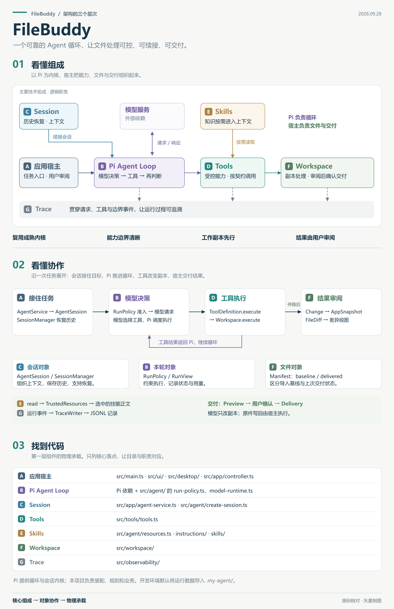

# FileBuddy

一个 Windows 桌面文件助手：用自然语言批量修改文本、整理目录，并在查看差异后导出结果或确认写回原件。基于 Electron、TypeScript 和 Pi 0.87.1。

**许可**：源码公开，采用 [PolyForm Noncommercial 1.0.0](./LICENSE)，使用范围见下方[许可证说明](#许可证)。

- **先处理副本**：导入文件与目录后，模型在独立工作副本上操作。
- **可以持续对话**：会话持久保存，支持追加要求、停止运行和压缩上下文。
- **交付前可审阅**：逐行查看差异，导出 ZIP，或确认后应用回原件；写回包含冲突检查与备份。
- **过程可追溯**：显示模型与工具进度，支持导出运行记录；可直接查看仓库中的 [Trace 运行记录示例](./trace运行记录.jsonl)。

当前主要处理 UTF-8 文本（如 `.txt`、`.md`、代码文件），不提供 Word、PDF 或 Excel 的内容解析。模型能力由用户配置的 API 服务提供。

## 架构概览

Pi 负责模型与工具之间的循环及会话机制；本项目负责桌面界面、受限文件工具、工作副本、运行约束与交付确认。



[打开高清原图（4400 × 6800）](./filebuddy-architecture-essential-20260928.png) · [阅读完整架构说明](./ARCHITECTURE.md)

### Trace 运行记录示例

根目录的 [trace运行记录.jsonl](./trace运行记录.jsonl) 是一份可公开的实际运行记录，每行一个 JSON 事件。这份样例包含 **654 条事件、26 次模型请求与响应、40 次工具调用**，展示了应用宿主如何记录 Pi 模型与工具循环的执行过程：

- `run_start` / `run_end`：记录运行范围、最终状态、累计用量和调用次数。
- `budget_check`、`model_request` / `model_payload` / `model_response`：记录预算检查、请求参数摘要、Token 用量及耗时。
- `model_stream_progress`：记录 Pi 流事件层的首内容等待、输出进度及内容间隔等指标。
- `tool_start` / `tool_end`：记录工具名称、参数摘要、执行状态、耗时与结果哈希。

通过 `sessionId`、`runId` 定位会话和运行，再用 `eventId` / `parentId` 关联请求与响应、工具开始与结束事件。阅读指标的方法见[模型超时与运行记录](#模型超时与运行记录)。

公开样例已将工具参数中的材料相对路径替换为一致的示例名称，保留原始事件关联、时间、计数、哈希和状态；记录中的哈希仍对应原始运行数据。本次最终状态为 `ready_for_review`，表示等待用户检查结果，不代表已经确认写回原件；本样例未触发上下文压缩或重试。

## 在 Windows 上安装并运行源码

**当前仓库提供源码运行方式，尚未提供可双击安装的 `.exe` / `.msi` 安装包，也没有安装包打包命令。** 按下面步骤安装依赖后，即可在本机运行桌面客户端。`npm.cmd run build` 只生成 `dist/` 程序文件，不会生成独立安装包。

### 1. 准备环境与源码

- 安装 [Node.js](https://nodejs.org/en/download)：建议使用 24 LTS，项目最低要求为 **22.19.0**，安装时保留 npm 并加入 PATH。
- 准备模型服务的 API Key，以及该账户可以调用、支持流式工具调用的模型 ID。
- 在本 GitHub 仓库页面选择 **Code → Download ZIP**，解压到可写目录，例如 `D:\Apps\FileBuddy`。也可以复制仓库页面提供的 HTTPS 地址，用 Git 克隆；下载 ZIP 不需要安装 Git。
- 打开 PowerShell，进入包含 `package.json` 的项目根目录。下面的路径请替换成你的实际解压目录。

```powershell
cd D:\Apps\FileBuddy
```

确认 Node.js 和 npm 可用（安装 Node.js 后需要重新打开 PowerShell）：

```powershell
node --version
```

```powershell
npm.cmd --version
```

下文使用 `npm.cmd`，便于直接在 Windows PowerShell 中执行。

### 2. 安装依赖与 Electron

依次执行，等待每一步成功完成。首次安装需要联网下载 npm 依赖及 Electron 运行时：

```powershell
npm.cmd ci --ignore-scripts
```

```powershell
node node_modules/electron/install.js
```

第一条命令根据仓库中的 `package-lock.json` 安装依赖并跳过自动安装脚本，第二条单独安装 Electron。`node_modules/` 由这些命令生成，源码仓库无需包含它。[npm ci 说明](https://docs.npmjs.com/cli/v11/commands/npm-ci/) · [Electron 安装说明](https://www.electronjs.org/docs/latest/tutorial/installation)

### 3. 配置模型

首次使用时复制配置模板；已有 `.env` 时直接编辑它，不要用模板覆盖自己的配置：

```powershell
Copy-Item .env.example .env
```

```powershell
notepad .env
```

至少填写以下三项。这里是 Moonshot 的配置示例，`kimi-k3` 需在你的账户中可用；Key 请替换为你自己的真实值，仅保存在本机 `.env` 中：

```dotenv
AGENT_BASE_URL=https://api.moonshot.cn/v1
AGENT_MODEL=kimi-k3
AGENT_API_KEY=replace_with_your_api_key
```

| 配置项           | 如何填写                                                                                                                                     |
| ---------------- | -------------------------------------------------------------------------------------------------------------------------------------------- |
| `AGENT_BASE_URL` | 模型服务 API 基础地址，通常以 `/v1` 结尾；不要填聊天网页地址或完整 `/chat/completions` 路径。远程地址必须使用 HTTPS，本机回环地址允许 HTTP。 |
| `AGENT_MODEL`    | 上述服务中账户实际可调用的模型 ID，不是随意填写的显示名称。                                                                                  |
| `AGENT_API_KEY`  | 对应服务的 API Key，必填。应用通过本地主进程向该服务认证，不在页面展示 Key。                                                                 |

当前适配的是 **OpenAI 兼容的 Chat Completions API**，需要支持流式输出和工具调用。K3 使用 `max_completion_tokens`、明确的 `reasoning_effort` 和流式 usage，并保留多轮推理字段；其他模型仍需验证其协议兼容性。原生 Anthropic / Gemini 接口或只支持 Responses 的接口不能直接套用此配置。

完整选项见 [.env.example](./.env.example)。一般只需修改以上三项，其他保持模板默认值。所有配置修改都需要**完全退出客户端再重新启动**；已有的同名系统环境变量优先于 `.env`。文件名必须恰好是 `.env`，不能是 `.env.txt`。

配置由 [src/config.ts](./src/config.ts) 统一读取、校验并冻结，分为 `model`、`run`、`workspace`。优先级为系统环境变量 > `.env` > 代码默认值；空白数值使用默认值，空白累计预算表示不限额，非法非空值明确报错。系统中的空值也会覆盖 `.env`，不会偷偷回退到文件中的同名值。业务模块只接收本次生效配置，不重复读取环境变量或再次施加固定默认上限。

`AGENT_CONTEXT_WINDOW` 与 `AGENT_MAX_OUTPUT_TOKENS` 表示模型上下文与输出能力边界，K3 默认均为 1,048,576。普通请求和摘要请求的输出预算分别由 `AGENT_RUN_OUTPUT_TOKENS`、`AGENT_COMPACTION_OUTPUT_TOKENS` 控制，各自默认 32,768，**不会跟随模型能力上限变化**。缩小模型能力时，若运行预算不再适配，应同时显式修改运行预算，配置校验会报错而不是偷偷夹小。

K3 主对话推理默认 `high`，摘要默认 `low`，分别通过 `AGENT_REASONING_EFFORT`、`AGENT_COMPACTION_REASONING_EFFORT` 调整；该模型不支持关闭思考。安全预留默认 8,192，压缩比例默认 0.9。压缩水位按 `floor((contextWindow - max(outputTokens, compactionOutputTokens) - safetyTokens) * compressionRatio)` 得到，默认 906,854 Token，不另存一份水位配置。自动压缩近期历史目标默认 65,536 Token，小窗口另受近期历史比例约束。

K3 在请求准入和压缩判断时，通过官方 token 计数接口计算实际消息与工具定义的输入量。计数失败明确停止，不以字符粗估静默放行；`model_payload` 记录最终发出的输出参数、推理级别和输入计数，便于核对配置是否真正生效。

本机 `.env` 是覆盖入口，`src/config.ts` 是默认值与校验的唯一执行来源，`.env.example` 是无密钥模板。留空的可选项采用代码默认值。默认值是初始策略，模型规格依据 [K3 官方说明](https://platform.kimi.com/docs/guide/kimi-k3-quickstart)。

工作区导入、文本字节、读取分页和工具参数上限也由同一配置供执行检查、工具参数定义和错误提示使用。`XUWU_READ_MAX_BYTES` 限制读取正文，`AGENT_TOOL_RESULT_MAX_BYTES` 限制包装后的完整 JSON，两者单位都是字节但职责不同。工具写入字符串长度与最终 UTF-8 文件字节数也分别校验。其他较少调整的策略保留为该文件中的命名默认值，无需新增配置服务。

### 4. 启动客户端

双击项目根目录中的 **启动客户端.cmd**。它会先构建，再独立打开客户端窗口，启动命令窗口随后自动退出。以后使用仍双击这个文件；也可以为它创建桌面快捷方式。

需要在终端查看构建和运行输出时，在项目根目录执行：

```powershell
npm.cmd start
```

看到客户端窗口表示桌面程序已启动；添加下面的示例材料并完成一次任务，才能确认模型配置可用。模型调用会使用你所配置服务的额度。

源码运行依赖整个项目目录及其中安装的依赖，请保留这些文件。更新源码后重新安装依赖、退出旧客户端并再次启动；保留自己的 `.env` 和 `.my-agent/`，后者包含本地会话、工作副本和备份。

## 使用

1. 新建会话，点击“添加文件”或“添加目录”；可多次追加，也可拖入文件和目录。新会话无需命名；首次输入任务时，以开头 16 个字符自动命名，首次发送后固定。点击侧边栏会话右侧的铅笔按钮可修改名称（最多 80 个字符），手动名称会保留并在重启后恢复。
2. 在输入框描述任务，按“开始处理”或 Ctrl+Enter。运行中可以追加任务，也可以停止。
3. 在右侧点击“查看差异”：左右按行对齐显示处理前与当前副本，粉色 `-` 标记删除、绿色 `+` 标记新增，并显示各自行号与改动行数。仅显示改动附近的上下文，长行自动换行、两侧同步滚动；无末尾换行、空文件、编码与换行格式会单独提示。继续对话可修改结果。
4. “导出结果”生成 ZIP；“应用回原件”先显示具体变更，再检查原件是否变化并建立备份。
5. “运行记录”导出最近一次运行的脱敏 JSONL trace。上下文会在发送新任务前、以及运行中每批工具执行完后自动检查，达到水位时自动压缩并继续；“压缩上下文”按钮用于主动提前整理历史。默认压缩水位为 906,854 Token。摘要失败或压缩后仍无法满足请求窗口时停止并保留已有结果。
6. 点击侧边栏会话右侧的垃圾桶按钮可删除该会话，无需先切换。删除前会显示会话名称并要求确认，默认选择取消；确认后移除会话历史、运行记录和工作副本，原始文件不受影响。

对话列表会在开始处理时立即显示运行状态。Agent 应在开始和关键阶段提供简短说明，正文仍以 **FileBuddy** 署名流式显示；连续没有正文时，程序根据真实模型与工具事件补充标为“运行状态”的反馈。状态保存在会话中，停止或重新打开后仍可查看；这些程序生成的状态不进入模型上下文，也不表示任务已经完成。

无正文时的反馈间隔默认 **15 秒**，由 `AGENT_PROGRESS_SILENCE_MS` 配置（毫秒，1–2147483647 的整数），修改后重启生效。它是第一版的可调反馈节奏，不是运行时限；正在输出正文时不重复添加状态，相同状态不重复追加，也不会逐次工具调用刷屏。

底部运行条继续显示等待首段内容、正在推理、正在生成正文或工具参数，以及已收到的内容字符数、距上次有效内容的时间。这里只展示进度统计，不展示推理正文。

可以先添加 `samples/会议整理`，试着说：

> 使用文本整理技能，把所有文件中的项目代号“青禾”改为“星河”，合并多余空行。保留日期和 KEEP-42 标记。

继续说：

> 将交付日期改为 2026-10-15，并新增一份 summary.txt，汇总项目代号、日期和保留标记。

应用界面上点击“运行记录”可导出当前会话最近一次运行；故障后建议先导出再继续任务。原始记录默认在 `.my-agent/traces/<会话ID>/<运行ID>.jsonl`；设置 `XUWU_DATA_DIR` 后位于该目录的 `traces/` 下。先看 `run_end` 与 `boundary_decision`，再按 `parentId` 配对 `model_request/model_response`、`tool_start/tool_end`：

- `MODEL_IDLE_TIMEOUT`：没有在等待时限内收到有效内容。`timeoutKind=first_content/idle` 和 `timeoutPhase=waiting_first_content/streaming` 区分首段等待与流中途停滞。
- `model_request.timeouts.totalMs=null`：未设置请求总时限；`firstContentMs` 和 `idleMs` 分别记录首内容与后续无有效内容阈值。
- `model_stream_progress`：首段内容、阶段变化及流活跃期间约每秒的统计快照；不记录正文。
- `model_response.streamMetrics` 和超时事件记录 `firstEventAt/firstEventLatencyMs`、`firstContentAt/firstContentLatencyMs`、`lastEventAt/lastContentAt`、`eventCounts`、`characters`、`maxContentGapMs`、`idleForMs`。尚未收到事件/内容时对应时间为 `null`。

这些时间来自 Pi 解析后的流事件（`measurementScope=pi_stream_events`），不是底层网络首字节时间。`start` 可能仅代表响应头已到达；空增量、块边界和网络心跳不会刷新有效内容时限。因此诊断停滞应重点看 `lastContentAt`，而非可能包含终止事件的 `lastEventAt`。持续有内容只说明调用仍有活动，任务是否推进仍需结合工具结果和文件变化判断。`source=reservation_unknown_actual` 表示失败请求的实际 token 用量未知，预算保留了预留估算，不能当作已确认账单。

历史 trace 可能包含旧策略的 `MODEL_TOTAL_TIMEOUT`、`timeoutKind=total`、`RUN_TIMEOUT` 或非空 `totalMs`；这些记录保留当时的行为，不代表当前仍有总时限。

## 数据与边界

- 所有 Agent 修改先发生在独立副本中。原件只有在交付确认后才会更新。
- 工作数据与会话默认保存在 `.my-agent/`，可用 `XUWU_DATA_DIR` 指定其他位置；会话恢复后可继续处理同一批副本。
- 文本处理支持 UTF-8/UTF-8 BOM，保留换行格式。其他编码与超大文本明确报错，二进制只作不透明附件保存。
- 默认单文件导入上限 16 MiB、总导入 128 MiB、最多 1000 文件；文本编辑上限 4 MiB，可在配置入口调整。文件数量和字节数分别受限，不随模型窗口同比放大。
- 敏感配置、凭据、链接及特殊路径默认跳过或拒绝；界面会显示原因。
- 模型没有 shell、任意脚本、网络浏览、提醒创建或直接写回原件工具。
- 使用外部模型时，被读取的任务材料片段会发送给已配置的模型服务。完整对话和工具结果可能留存在本地 Pi 会话中。
- 多文件写回逐项执行，发生冲突或部分失败会报告，不能保证多文件整体原子更新。支持从写回备份恢复，并防止覆盖之后的外部修改。
- 跨导入根移动显示为删除与新增；没有来源映射的新文件只能导出。文件与目录互换类型不支持直接写回。
- Token 用量先估算、再按可用的供应商 usage 校正；只有显式配置的累计用量和调用次数上限才会拦截运行。模型无有效内容时限、工具超时和上下文容量保护独立生效。

## 常见问题

| 现象                                          | 处理方式                                                                                                                                  |
| --------------------------------------------- | ----------------------------------------------------------------------------------------------------------------------------------------- |
| 提示找不到 `node` 或 `npm.cmd`                | 安装符合版本要求的 Node.js，重新打开 PowerShell，然后检查版本。                                                                           |
| Electron 下载失败，或提示 Electron 未正确安装 | 检查网络能否访问 Electron 的下载服务；恢复网络后重新执行 `node node_modules/electron/install.js`。若缺少 npm 依赖，先完成前一步依赖安装。 |
| 双击启动后没有出现窗口                        | 查看 `.my-agent/launcher.log`、`.my-agent/build.log` 与 `.my-agent/client.stderr.log`；也可用 `npm.cmd start` 查看终端输出。              |
| 能打开窗口，但开始任务时提示未配置 Key        | 确认 `.env` 位于 `package.json` 旁边、文件名无 `.txt` 后缀，填写 `AGENT_API_KEY` 后完全退出并重启。                                       |
| 模型返回认证、模型不存在或参数不兼容错误      | 核对服务地址、Key、模型 ID、账户权限和额度；确认服务支持上文说明的流式工具调用及请求参数。                                                |
| 长时间没有模型内容而停止                      | 默认首内容等待 300 秒、输出后无有效内容 90 秒；可按上文分别调整两个阈值，并导出运行记录排查。                              |

双击启动的构建与运行输出分别写入 `.my-agent/build.log`、`.my-agent/client.stdout.log` 和 `.my-agent/client.stderr.log`，启动步骤写入 `.my-agent/launcher.log`。这些日志仅保留在本机。
                                   |

## 验证

```powershell
npm.cmd run typecheck
```

```powershell
npm.cmd test
```

```powershell
npm.cmd run verify:live
```

```powershell
npm.cmd run verify:defaults-live
```

```powershell
npm.cmd run verify:desktop
```

`typecheck` 与 `test` 不需要真实 API Key，也不调用外部模型。`verify:live` 和 `verify:desktop` 会调用 `.env` 中的真实模型并消耗其额度，只处理 `evidence/private/` 中专门生成的测试材料。测试结果写入本机 `evidence/`，不会随源码提交。桌面测试操作真实 Electron 界面，系统原生文件选择/保存/确认弹窗使用确定性返回值测试；不把这部分算作人工系统弹窗验收。

`verify:defaults-live` 使用本机 `.env` 与代码默认值，在系统临时目录生成隔离的合成材料，验收文件修改、原件保护、真实摘要、超过 64K 的输入以及默认水位自动压缩。自动压缩通过 `AgentService.openSession/send` 的生产入口验证。它包含接近 1M 的真实输入，会产生显著用量；不应把它当作每次启动的健康检查。失败报告与已通过阶段都会保留在 `evidence/`。直接运行脚本时，`--long-only` 只复查长输入和自动压缩，`--compaction-only` 只复查默认水位自动压缩，`--output-only` 单独校验实际超过 4096 Token 的完整输出；执行时同样使用真实模型。

只验证差异界面的显示，可运行 `npm.cmd run verify:diff-ui`；它使用隔离界面与测试数据，不调用模型。安装和日常使用不要求执行上述验证命令。

## 代码职责

| 目录或文件                       | 职责                                        |
| -------------------------------- | ------------------------------------------- |
| `src/main.ts`、`src/desktop/`    | Electron 启动、桌面通信与受控接口。         |
| `src/ui/`                        | 会话、材料、运行进度和文件差异界面。        |
| `src/app/`                       | 应用编排、会话服务及界面数据。              |
| `src/config.ts`                  | 配置默认值、读取优先级、统一校验和只读生效值。 |
| `src/agent/`                     | Pi 会话装配、模型通信适配、资源加载与运行策略执行。 |
| `src/tools/`                     | 注册模型可调用的受限工具。                  |
| `src/workspace/`                 | 工作副本、文件操作、差异、交付与冲突保护。  |
| `src/observability/`             | 模型流统计与 trace。                        |
| `instructions/`、`skills/`       | 应用维护的系统指令与按需读取的技能。        |
| `scripts/`、`tests/`、`samples/` | 构建启动、验证测试和演示材料。              |

完整设计见 [ARCHITECTURE.md](./ARCHITECTURE.md)。

## 许可证

FileBuddy 采用 [PolyForm Noncommercial License 1.0.0](./LICENSE)。以下为便于阅读的摘要，具体权利、义务和限制以 `LICENSE` 中的英文原文为准：

- **非商业用途**：允许非商业使用，包括个人学习、自用，以及没有预期商业应用的个人研究、实验、测试和兴趣项目。
- **机构使用**：允许慈善组织、教育机构、公共科研组织、公共安全或卫生组织、环保组织及政府机构使用，不受其资金来源或由资助产生的义务影响。
- **修改与分发**：可为许可范围内的目的修改代码或创作衍生作品；分发软件及获准的修改版本时，须向接收者提供许可证全文或链接，并保留许可方提供的 `Required Notice:` 通知。

本许可证不授予一般商业用途的使用或修改权利；超出许可范围的商业使用需要另行获得权利人授权。FileBuddy 属于**源码公开、限制商业使用**的项目（source-available），不属于 [OSI 定义的开源软件](https://opensource.org/osd)。

第三方依赖及另有许可声明的材料继续适用其各自许可证。
